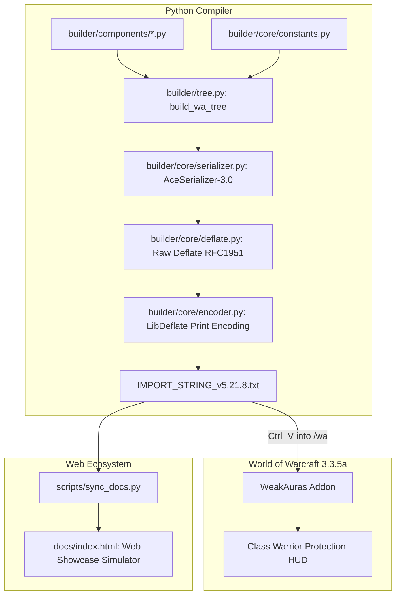

# System Architecture — Class Warrior (Protection) WeakAuras Suite

## 1. Panoramica Architetturale

La suite **Class Warrior (Protection)** per World of Warcraft 3.3.5a (*Wrath of the Lich King - Build 12340*) è progettata secondo un'architettura **Compiler-Driven Component-Based**: l'intero albero dati gerarchico di WeakAuras non viene manipolato manualmente in Lua né esportato empiricamente in gioco, ma viene modellato e generato programmaticamente da una pipeline Python dedicata (`builder/`).

Il compilatore serializza l'albero nel formato binario di **AceSerializer-3.0**, comprime il payload con l'algoritmo **Deflate** (RFC 1951, compressione raw senza header zlib) e codifica il risultato tramite il charset di stampa a 64 caratteri sicuri di **LibDeflate**, producendo la stringa standard `!WA:1!...` pronta per l'importazione diretta con `Ctrl+V` in gioco.



---

## 2. Struttura del Package Python `builder/`

La cartella sorgente `builder/` è articolata in moduli indipendenti e riutilizzabili:

```text
builder/
├── core/                        # Motore di serializzazione, codifica e costanti
│   ├── constants.py             # Condizioni di caricamento, palette RGB, metriche grafiche e spell IDs
│   ├── serializer.py            # Implementazione pura Python di AceSerializer-3.0 (^1...^^)
│   ├── deflate.py               # Compressione Deflate senza header zlib e tabella caratteri LibDeflate
│   ├── encoder.py               # Assemblatore finale stringa !WA:1!
│   ├── helpers.py               # Funzioni ausiliarie per subtext, subbackground e glow
│   └── __init__.py              # Export pubblico del modulo core
│
├── components/                  # Moduli verticali dei 20 componenti HUD
│   ├── procs.py                 # 01 - Procs warTank (Dynamic Group: Sword & Board, Revenge Ready warTank, Shield Block, Emergency HP, Tank Buster)
│   ├── buffs.py                 # 02 - Battle Shout, 03 - Commanding Shout, 04b - Vigilance (Focus Magic model), 04 - Defensive Stance
│   ├── utility.py               # 05-13 - Riga Utility Adattiva (Trinket 1/2, Ring, Cloak Proc-Only, Tier Set Proc-Only, Enchants Proc-Only, Gloves, Shield Wall warTank, Last Stand warTank, Boots)
│   ├── bars.py                  # 14 - Rage Bar warTank & 16 - Castbar warTank (con Kick Advisor integrato)
│   ├── rotational.py            # 15 - Rotational Bar warTank (Indicatore statico di accodamento 278x7px per HS/Cleave con Pixel Glow)
│   ├── alerts.py                # 17 - Alerts warTank (Gruppo avvisi sonori e visivi per emergenze difensive e interrupt)
│   ├── stats.py                 # 18 - Stats Panel warTank (Pannello 96x60px difensivo: Armor, Def, Block, CTC, Hit/Exp)
│   ├── sunder.py                # 19 - Sunder Armor Tracker warTank (32x32px a x=160, y=-7 con supporto Expose Armor & Acid Spit)
│   └── __init__.py              # Export aggregato dei builder dei componenti
│
└── tree.py                      # Assemblatore dell'albero gerarchico master (Root Group + 20 children controllati)
```

---

## 3. Specifiche del Protocollo di Serializzazione & Compressione

WeakAuras per World of Warcraft 3.3.5a impiega un protocollo standardizzato a tre livelli per l'interscambio delle tabelle dati:

1. **AceSerializer-3.0**:
   - Marcatore di apertura: `^1`
   - Marcatore di chiusura: `^^`
   - Tipi supportati e codifica binaria:
     - Tabelle associative / dizionari: `^T...^t`
     - Numeri interi: `^N<valore>` (es. `^N1` per array index 1, `^N90` per internalVersion)
     - Stringhe: `^S<valore>` con sequenze di escape per caratteri di controllo (es. `~z` per byte 30, `~}` per `^`, `~|` per `~`).
     - Booleani: `^B` per `true`, `^b` per `false`.
     - Valori nulli: `^Z`.
   - **Regola Vincolante per i Trigger**: Le mappe dei trigger WeakAuras **devono** avere chiavi numeriche intere (`1: { ... }` $\rightarrow$ `^N1`) e **non** stringhe (`"1": { ... }` $\rightarrow$ `^S1`). Le chiavi stringa impediscono la scansione con `ipairs` e provocano il blocco totale del deserializzatore durante l'importazione. Inoltre ogni mappa trigger deve contenere `"activeTriggerMode": -10`.

2. **Compressione RFC 1951 (Raw Deflate)**:
   - Stream compresso generato con `zlib.compressobj(level=9, method=zlib.DEFLATED, wbits=-15)` (finestra raw a 15 bit senza wrapper o checksum zlib/gzip).

3. **LibDeflate Print Encoding**:
   - Tabella di conversione a 64 caratteri sicuri per la chat e le editbox di WoW (`a-z`, `A-Z`, `0-9`, `(`, `)`).
   - Prefisso di compatibilità globale: `!WA:1!`.

---

## 4. Griglia Coordinate a Schermo e Layout HUD

L'HUD è ancorato al centro dello schermo (`anchorPoint: "CENTER"`, `selfPoint: "CENTER"`) con un offset base verticale di `yOffset = -190`, posizionandosi esattamente sotto il modello del personaggio per garantire piena visibilità delle pozze e dei debuff a terra.

Le tre barre orizzontali condividono la larghezza calibrata di **278 px**:

```text
                  [ 17 - Alerts warTank (y = +78) ]
           [ 01 - Procs warTank (Dynamic Group, y = +52) ]

================== [ 16 - Castbar warTank (278x20px, y = +8) ] ==================
---------------- [ 15 - Rotational Bar (Swing Timer 278x7px, y = -7) ] ----------  [ 19 - Sunder ]
==================== [ 14 - Rage Bar (278x14px, y = -20) ] =====================

[ Shouts & Stance ]                                            [ Utility Row ]
(x = -231, -205, -179, -153, y = 0, 24x24px)                  (y = -45, 10 icone)
[ 18 - Stats Panel ]
(x = -192, y = -45, 96x60px)
```

| ID Modulo | Nome Componente | Dimensioni | Coordinate (X, Y) | Comportamento e Funzionalità |
| :--- | :--- | :--- | :--- | :--- |
| **Root** | `Class Warrior (Protection)` | Scale 1.2 | X: 0, Y: -190 | Gruppo master contenitore con icona Defensive Stance e bootstrap core |
| **01** | `01 - Procs warTank` | 34x34 px (icone) | X: 0, Y: +52 | Dynamic group orizzontale con sort="none" (gerarchia da sinistra a destra): 1. Emergency Low HP, 2. Tank Buster, 3. Revenge Ready warTank, 4. Sword and Board, 5. Demoralizing Shout, 6. Thunder Clap, 7. Rend. Parità visiva 1:1 tra SAB e REV (34x34, auto=False, cooldownEdge=False, subbackground, timer decimale %p in basso, etichette SLAM/REV centrate in alto, Gold Pixel Glow identico). Gestione multi-proc dinamica con riavvio swipe a 5.0s su re-proc e scomparsa immediata al lancio di Shield Slam/Revenge. Debuff bersaglio filtrati a vita totale >= 500k HP |
| **02** | `02 - Battle Shout warTank` | 24x24 px | X: -231, Y: 0 | Monitoraggio buff; soppresso intelligentemente da Blessing of Might del Paladino |
| **03** | `03 - Commanding Shout warTank`| 24x24 px | X: -205, Y: 0 | Buff salute; soppresso intelligentemente da Blood Pact dell'Imp del Warlock |
| **04b** | `04b - Vigilance warTank` | 24x24 px | X: -179, Y: 0 | Allerta Vigilanza mancante su alleato (OFF stile Focus Magic) e timer scadenza (<= 60s) |
| **04** | `04 - Defensive Stance warTank`| 24x24 px | X: -153, Y: 0 | Allerta visiva immediata e glow rosso se in combat fuori dalla Postura Difensiva |
| **05-13**| Utility Row (11 Icone) | 24-28 px | Y: -45, X centrato | Auto-centratura dinamica naturale per il War Tank: Trinket 1/2, Ring (Solo Ashen Band), Cloak (Solo Proc Ricamo Sartoria), Tier 10 (Solo 4P Shield Block), Enchants (Solo Proc Arma), Gloves (Solo Tinker), Shield Block warTank (Durata 10s & CD 30s/60s), Shield Wall warTank (-60%), Last Stand warTank (+30%), Boots (Solo Tinker/Regen) |
| **14** | `14 - Rage Bar warTank` | 278x14 px | X: 0, Y: -20 | Barra risorsa con cambio colore a soglia Heroic Strike/Cleave (>= 45 Rage) |
| **15** | `15 - Rotational Bar warTank` | 278x7 px | X: 0, Y: -7 | Swing timer mano primaria ad animazione progressiva e indicatore di accodamento (OnUpdate frame-rate): barra rame/bronzo a scorrimento tra attacchi con timer %c centrato, oro vibrante + Pixel Glow su Heroic Strike accodato, verde smeraldo + Pixel Glow su Cleave accodato |
| **16** | `16 - Castbar warTank` | 278x20 px | X: 0, Y: +8 | Gruppo Castbar speculare: Target dx->sx (Priorità 1, Shield Bash, Spell Reflection viola, Immune) e Player sx->dx (Priorità 2: lanci e canalizzazioni del tank) |
| **17** | `17 - Alerts warTank` | Testo 18-20pt | X: 0, Y: +78 | Avvisi critici di emergenza difensiva (<35% HP) e interruzione cast target (Zero Clutter: banner testuali rotazionali rimossi) |
| **18** | `18 - Stats Panel warTank` | 96x60 px | X: -192, Y: -45 | Pannello difensivo compatto a 5 righe per il War Tank (Def 540 Cap, Armor in k, CTC 102.4%, Block %, Hit & Exp, senza % Armor e SBV per massima chiarezza e compattezza) |
| **19** | `19 - Sunder Armor Tracker warTank` | 32x32 px | X: +160, Y: -7 | Monitoraggio cariche (1-5) e durata Sunder Armor (Warrior), Expose Armor (Rogue) o Acid Spit (Hunter); nome univoco anti-conflitto |

---

### 4.1 Architettura Riga Utility Auto-Adattiva a Centratura Dinamica per il War Tank

La riga utility inferiore (`05` - `13`) a $y = -45\text{ px}$ adotta un'architettura a centratura dinamica naturale concepita specificamente per il War Tank. Invece di posizionare staticamente 11 icone fisse (che lascerebbero buchi visivi o genererebbero derive verso destra in base alla configurazione difensiva del tank), il motore `_G.PWHUD_UpdateUtilityRowPositions()` esegue un censimento reattivo dell'equipaggiamento e delle abilità qualificate del tank, costruendo la lista `activeOrder` e riposizionando tutte le icone perfettamente centrate attorno a $x = 0$ sotto la barra della rabbia da $278\text{ px}$.

#### Formula di Calcolo Orizzontale:
$$\text{targetX} = \left\lfloor \left( i - \frac{N + 1}{2} \right) \times \text{step} + 0.5 \right\rfloor$$
- $i$: indice ordinale dell'icona nell'array `activeOrder` ($1 \le i \le N$).
- $N$: cardinalità dell'array delle icone qualificate ($3 \le N \le 11$).
- $\text{step}$ e $\text{targetW}$: calcolati dinamicamente per preservare una larghezza totale inferiore a $278\text{ px}$:
  - $N \ge 11 \implies \text{step} = 25\text{ px}, \text{targetW} = 24\text{ px}$
  - $N = 10 \implies \text{step} = 27\text{ px}, \text{targetW} = 26\text{ px}$
  - $N = 9 \implies \text{step} = 29\text{ px}, \text{targetW} = 28\text{ px}$
  - $N = 8 \implies \text{step} = 32\text{ px}, \text{targetW} = 28\text{ px}$
  - $N = 7 \implies \text{step} = 38\text{ px}, \text{targetW} = 28\text{ px}$
  - $N = 6 \implies \text{step} = 44\text{ px}, \text{targetW} = 28\text{ px}$
  - $N = 5 \implies \text{step} = 48\text{ px}, \text{targetW} = 28\text{ px}$
  - $N \le 4 \implies \text{step} = 52\text{ px}, \text{targetW} = 28\text{ px}$

#### Regole e Specifiche Tassative di Filtraggio Oggetti (Whitelist Rigorosa):
1. **Trinket 1 & 2 (`05` & `06`, Slot 13/14)**: Sempre inclusi se l'oggetto è presente nello slot (`itemID > 0`). Gestiscono On-Use, ICD (45s–120s) e procs.
2. **Anello (`06b`, Slot 11/12)**: Incluso **SOLO ed esclusivamente** in presenza di *Ashen Band of Endless Courage* (Tank Armor proc, Spell ID 72414) o *Ashen Band of Endless Vengeance* (Melee AP proc, Spell ID 72412). Soppresso per anelli a sole statistiche statiche.
3. **Mantello (`07`, Slot 15)**: Incluso **SOLO ed esclusivamente** in presenza di incanto da combattimento proccabile (Sartoria: *Swordguard Embroidery* / *Ricamo della Spada*, Spell ID 55775, ID Incanto 3730). Paracadute d'Ingegneria (*Flexweave Underlay*) e incanti a statistiche statiche (+22 Agi, +16 Def, +225 Armor) sono **tassativamente soppressi**.
4. **Tier Set (`08`)**: Incluso **SOLO ed esclusivamente** in presenza di almeno 4 Pezzi Tier 10 (*Ymirjar Lord's Battlegear* 4P: bonus *Shield Block* magico -20% danno subito). Soppresso con 0, 1, 2 o 3 pezzi.
5. **Incanti Arma (`09`, Slot 16)**: Incluso **SOLO ed esclusivamente** se l'arma principale monta incanti con proc difensivo o offensivo (*Blade Ward*, *Blood Draining*, *Mongoose*, *Berserking*). Soppresso per incanti statici (Titanguard, Potency, ecc.).
6. **Guanti (`10`, Slot 10)**: Incluso **SOLO ed esclusivamente** se provvisti di tinker attivo d'Ingegneria (*Reticulated Armor Webbing* o *Hyperspeed Accelerators*).
7. **Cooldown Difensivi Guerriero (`10b`, `11`, `12`)**: Sempre presenti e saldamente integrati nella riga attiva prima degli stivali:
   - `10b - Shield Block warTank`: Durata attiva 10s e CD 30s/60s.
   - `11 - Shield Wall warTank`: Riduzione -60% danno, durata 12s, CD e glow di emergenza a <35% HP.
   - `12 - Last Stand warTank`: Vita massima +30%, durata 20s, CD e glow di emergenza a <35% HP.
8. **Stivali (`13`, Slot 8)**: Incluso se provvisti di tinker attivo d'Ingegneria (*Nitro Boosts*) oppure fallback di utilità su *Enraged Regeneration*.

---

## 5. Caching Lua e Ottimizzazione Prestazionale

In combattimento raid ad alta intensità (es. Lich King 25HC), il motore Lua di World of Warcraft 3.3.5a è suscettibile a picchi di garbage collection. Per mantenere il carico della CPU inferiore allo **0.1%**, la suite implementa due cache globali isolate:

1. **`_G.PWHUD_BuffCache`**:
   - Cache unificata dei buff del giocatore indicizzati per `spellId` e `name`.
   - Aggiornata al massimo una volta per frame (`GetTime() == c.time`).
   - Rileva istantaneamente sovrapposizioni di raid (`hasBoM`, `hasBloodPact`).

2. **`_G.PWHUD_DebuffCache`**:
   - Cache dei debuff target/player per monitorare i colpi letali dei boss (Soul Reaper, Impale, Gastric Bloat, Fusion Punch) senza eseguire scansioni ripetute dell'API `UnitDebuff`.

3. **Motore di Calcolo e Glossario Sigle Statistiche Tank (`_G.PWHUD_LastStatsText`)**:
   - Caching a 10 Hz (0.1s) per evitare ricalcoli costosi su ogni frame.
   - **`DEF` (Defense Skill)**: Cap **540** per immunità critici boss Lv.83 (-5.6% crit subito), **535** in Eroiche Lv.82.
   - **`ARM` (Armor & Physical DR% Contestuale)**: Armatura effettiva dinamica: calcolo a pari livello (Lv.80 con costante Blizzard $K = 15232.5 \implies 62.4\%$, esattamente conforme al tooltip della scheda PG in-game) in assenza di target; scalatura automatica in tempo reale a $K = 16635 \implies 60.3\%$ su Raid Boss / Skull Lv.83 (mitigazione fisica effettiva in raid). Hard Cap 75.0%.
   - **`CTC` (Combat Table Coverage)**: Copertura tabella colpi: $\text{Dodge} + \text{Parry} + \text{Block} + \text{BossMiss}$. A $\ge \mathbf{102.4\%}$ il tank è *Unhittable*. Include debuff non-stacking (*Insect Swarm* / *Scorpid Sting* max +3%).
   - **`Block` & `SBV` (Shield Block Value)**: Probabilità di blocco e assorbimento netto; scala danno e minaccia di *Shield Slam*.
   - **`Hit` & `Exp` (Expertise)**: Melee Hit (Cap 8% con *Heroic Presence* Draenei +1%), Soft Cap 26 (0% dodge del boss) ed Hard Cap 56 (0% parry del boss per azzerare *Parry-Haste*).

---

## 6. Condizioni di Caricamento (Load Conditions) — Spec Protection Only

Per garantire che la suite si attivi **esclusivamente** quando il personaggio è specializzato Guerriero Protezione (Protection Warrior) con il talento **[Devastate]** appreso, le condizioni di caricamento sono definite a livello di master group e propagate uniformemente a tutte le 43 aure figlie:

```python
PROT_WARRIOR_LOAD = {
    "use_class": True,
    "class": {"single": "WARRIOR", "multi": {"WARRIOR": True}},
    "use_talent": True,
    "talent": {"single": 103, "multi": {103: True}},
    "use_vehicle": False,
}
```

### Calcolo Matematico dell'Indice Talento in WeakAuras 3.3.5a:
In WeakAuras per la build 12340, `WeakAuras.CheckTalentByIndex(index)` mappa l'albero tramite:
$$\text{tab} = \left\lceil \frac{\text{index}}{40} \right\rceil, \quad \text{num\_talent} = ((\text{index} - 1) \bmod 40) + 1$$
- **Tab 1**: Arms (indici 1–31)
- **Tab 2**: Secondo albero talenti (indici 41–80)
- **Tab 3**: Protection (indici 81–107)
All'interno del Tab 3 (Protection), **Devastate** (Spell ID: `20243`) si trova al Tier 8, Colonna 1, occupando l'ordinale **23**. L'indice WeakAuras risulta quindi:
$$\text{Index} = (3 - 1) \times 40 + 23 = \mathbf{103}$$

---

## 7. Rilevamento e Alerting Postura Errata (Out-of-Stance) in Combattimento

La gestione della postura è critica per la sopravvivenza del Protection Warrior in raid e dungeon. Un guerriero che affronta il combattimento fuori da *Defensive Stance* perde il 10% di mitigazione passiva, il bonus di Threat moltiplicato e l'accesso ad abilità salvavita (*Shield Block*, *Shield Wall*, *Revenge*).

Coerentemente con la filosofia **Zero Clutter** progettata per offrire al War Tank la massima visuale libera sul boss e sul posizionamento in raid, l'architettura adotta un indicatore compatto altamente visibile ed elegante anziché banner testuali invasivi:
1. **Indicatore Locale su Slot Postura (`04 - Defensive Stance - OutOfStance`, UID `PWHUD_STANCE_WARN`)**:
   - Posizionato a $x = -158, y = 0$ (dimensione 28x28px, allineato alle shout e al pannello statistiche).
   - In postura difensiva corretta (`GetShapeshiftForm() == 2`) l'icona è **completamente invisibile** (zero distrazioni in combattimento).
   - Dotato di colore rosso allerta perentorio, Pixel Glow pulsante e label visiva `STANCE`.
   - Si attiva istantaneamente in combattimento quando `UnitAffectingCombat("player") and (GetShapeshiftForm() ~= 2)`.
   - Utilizza trigger event-driven basati su `PLAYER_REGEN_DISABLED`, `PLAYER_REGEN_ENABLED`, `UPDATE_SHAPESHIFT_FORM`, azzerando il consumo CPU a zero durante la normale postura difensiva.
2. **Eliminazione Banner Testuali Invasivi**:
   - Il precedente banner testuale centrale `Alert - Wrong Stance` è stato **definitivamente eliminato** (insieme a `Alert - Sword and Board` e `Alert - Boss Enraged`) per evitare ingombri visivi al centro dell'interfaccia e riservare l'area centrale unicamente ai cooldown difensivi critici di sopravvivenza estrema (<35% HP) e agli interrupt.
